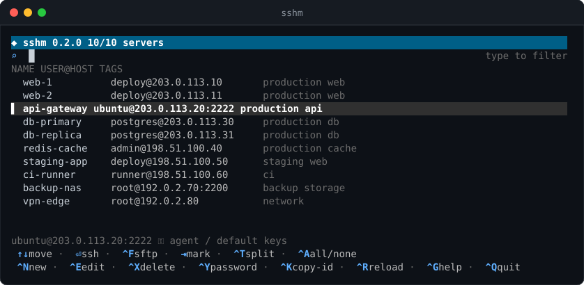
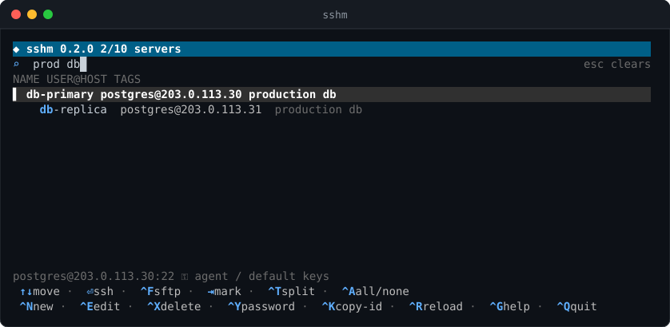
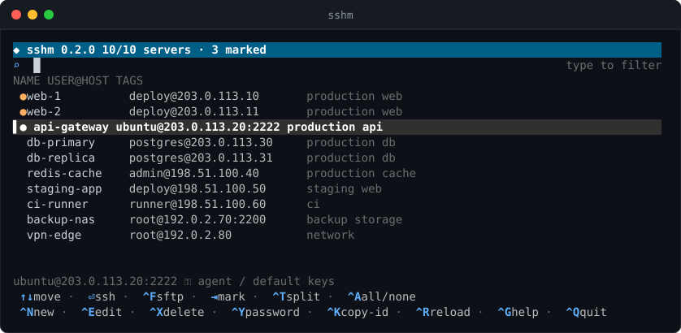
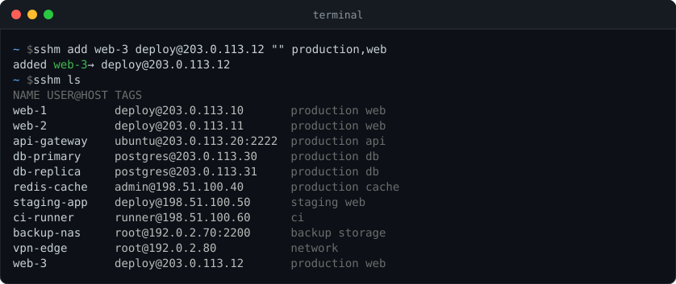

<h1 align="center">sshm</h1>

<p align="center">
  <b>A fast, keyboard-driven manager for your SSH and SFTP servers.</b><br>
  Find a server as you type, connect with one keypress, open several side by side.
</p>

<p align="center">
  <a href="https://www.npmjs.com/package/@parvvaresh/sshm"></a>
  <a href="https://github.com/parvvaresh/server-manager/actions/workflows/ci.yml"></a>
  
</p>

<p align="center">
  
</p>

```
npm install -g @parvvaresh/sshm
```

---

## Why sshm

If you look after more than a handful of machines, `~/.ssh/config` and shell
history stop being enough. sshm keeps every server in one small vault, with
its user, port, password or key, and tags, and puts a searchable list in front
of you whenever you type `sshm`.

- **Search as you type.** Filter by name, host, user, port or tag. Every word
  you type narrows the list further.
- **One key to connect.** <kbd>Enter</kbd> opens `ssh`, <kbd>Ctrl</kbd>+<kbd>F</kbd> opens `sftp`.
- **Many servers at once.** Mark a few with <kbd>Tab</kbd> and press
  <kbd>Ctrl</kbd>+<kbd>T</kbd> to open them all in one tiled tmux window.
- **Passwords or keys.** Password logins work with or without `sshpass`, and
  `copy-id` moves a server over to key based login in one step.
- **Encrypted vault.** Lock the vault with a master password using AES-256.
  The file is compatible with `openssl enc -aes-256-cbc -pbkdf2`, so you are
  never locked in.
- **Scriptable.** Everything the UI does is also a subcommand.
- **A single static binary.** Written in Go with no dependencies. npm is only
  the delivery route.

## Screenshots

**Search as you type.** Every term must match, so `prod db` finds the
production databases and nothing else.



**Mark several servers** with <kbd>Tab</kbd>, then press <kbd>Ctrl</kbd>+<kbd>T</kbd> to open them all
in a tiled tmux window.



**Use it from scripts** as well as from the UI.



## Install

### With npm (recommended)

```
npm install -g @parvvaresh/sshm
```

That's all. npm picks the prebuilt binary for your OS and CPU, so nothing is
compiled on your machine and Node is only needed to install. Supported
platforms are macOS and Linux, each on x64 and arm64.

Update or remove it the same way:

```
npm update -g @parvvaresh/sshm
npm uninstall -g @parvvaresh/sshm
```

<details>
<summary><b>Permission error during <code>npm install -g</code>?</b></summary>

Don't reach for `sudo`. Either install Node through a version manager such as
[nvm](https://github.com/nvm-sh/nvm), or point npm at a directory you own:

```
npm config set prefix ~/.local
export PATH="$HOME/.local/bin:$PATH"   # add this line to your shell profile
```

</details>

<details>
<summary><b>"the package @parvvaresh/sshm-… is missing"?</b></summary>

The binary is shipped as an optional dependency. Reinstall without
`--omit=optional` or `--no-optional`, and check that npm is not configured to
skip optional packages (`npm config get omit`).

</details>

### From source

You need Go 1.21 or newer.

```
go install github.com/parvvaresh/server-manager/cmd/sshm@latest
```

Or clone the repository and use the Makefile:

```
make install                      # installs to /usr/local/bin
make install PREFIX=$HOME/.local  # or anywhere else
```

### Runtime requirements

| Tool | Needed for |
| --- | --- |
| `ssh` | Connecting; already present on macOS and most Linux systems |
| `sftp` | SFTP sessions |
| `tmux` | Opening several servers side by side |
| `ssh-copy-id` | `copy-id`; ships with OpenSSH |
| `sshpass` | Optional. Without it, password logins go through a built-in askpass helper |

## Quick start

```
sshm add web-1 deploy@203.0.113.10 "" production,web   # name, user@host[:port], password, tags
sshm add db-1  postgres@203.0.113.30:2222                # port and tags are optional
sshm                                                     # open the UI
```

Run `sshm add` with no arguments to be asked for each field in turn. Leave the
password empty to use your SSH agent or default keys.

## Keyboard shortcuts

| Key | Action |
| --- | --- |
| *type anything* | Filter the list |
| <kbd>↑</kbd> <kbd>↓</kbd> <kbd>PgUp</kbd> <kbd>PgDn</kbd> <kbd>Home</kbd> <kbd>End</kbd> | Move |
| <kbd>Enter</kbd> | Connect with `ssh` |
| <kbd>Ctrl</kbd>+<kbd>F</kbd> | Connect with `sftp` |
| <kbd>Tab</kbd> | Mark or unmark the server |
| <kbd>Ctrl</kbd>+<kbd>A</kbd> | Mark all, or clear every mark |
| <kbd>Ctrl</kbd>+<kbd>T</kbd> | Open the marked servers in a tiled tmux window |
| <kbd>Ctrl</kbd>+<kbd>N</kbd> | Add a server |
| <kbd>Ctrl</kbd>+<kbd>E</kbd> | Edit the server |
| <kbd>Ctrl</kbd>+<kbd>X</kbd> | Delete the server |
| <kbd>Ctrl</kbd>+<kbd>Y</kbd> | Copy the server's password to the clipboard |
| <kbd>Ctrl</kbd>+<kbd>K</kbd> | Install your public key on the server |
| <kbd>Ctrl</kbd>+<kbd>R</kbd> | Reload the vault from disk |
| <kbd>Esc</kbd> / <kbd>Ctrl</kbd>+<kbd>U</kbd> | Clear the search |
| <kbd>Ctrl</kbd>+<kbd>G</kbd> | Help |
| <kbd>Ctrl</kbd>+<kbd>Q</kbd> | Quit |

## Commands

| Command | What it does |
| --- | --- |
| `sshm` | Open the interactive UI |
| `sshm add [NAME USER@HOST[:PORT] [PASS] [TAGS]]` | Add a server, from arguments or by prompting field by field |
| `sshm ls` | List every stored server |
| `sshm edit NAME` | Edit a server |
| `sshm rm NAME` | Delete a server |
| `sshm ssh NAME` | Connect with `ssh` |
| `sshm sftp NAME` | Connect with `sftp` |
| `sshm multi NAME NAME ...` | Open all of them in a tiled tmux window |
| `sshm copy-id NAME [KEYFILE]` | Install your public key on the server |
| `sshm lock` | Encrypt the vault with a master password |
| `sshm unlock` | Decrypt the vault back to plain text |
| `sshm export [--with-passwords]` | Write the vault as TSV to standard output |
| `sshm import FILE.tsv` | Merge servers from a TSV file, skipping duplicates |
| `sshm where` | Print the path of the vault in use |
| `sshm version` | Print the version |
| `sshm help` | Show the built-in help |

### Recipes

Open three servers side by side:

```
sshm multi web-1 web-2 db-1
```

Move from passwords to keys:

```
sshm copy-id web-1          # runs ssh-copy-id with its default key, or pass a KEYFILE
sshm edit web-1             # then clear the password field
```

Back up the vault, passwords included, and restore it on another machine:

```
sshm export --with-passwords > backup.tsv
sshm import backup.tsv
```

Keep the vault encrypted when you are not editing it:

```
sshm lock
```

## Configuration

### Where the vault lives

The vault directory is the first of these that is set:

1. `$SSHM_HOME`
2. `$XDG_CONFIG_HOME/sshm`
3. `~/.config/sshm`

Inside it, `servers.tsv` is the plain vault and `servers.enc` the encrypted
one. Only one of them exists at a time: `sshm lock` replaces the first with
the second, and `sshm unlock` does the reverse. Run `sshm where` to see which
one is in use.

### Environment variables

| Variable | Effect |
| --- | --- |
| `SSHM_HOME` | Directory holding the vault |
| `SSHM_SSH_OPTS` | Extra flags passed to `ssh`, for example `-o StrictHostKeyChecking=accept-new` |
| `XDG_CONFIG_HOME` | Used to derive the default vault directory |

## Security

Passwords are stored so that connections open without typing them. While the
vault is **unlocked** they sit on disk in plain text, protected only by the
`600` file mode. Treat it accordingly:

- Run `sshm lock` when you are done editing. The encrypted vault uses AES-256
  with a PBKDF2-derived key.
- Prefer keys over passwords. `sshm copy-id` installs your public key on a
  server, after which the password field can be left empty.
- Only `sshm export --with-passwords` writes passwords out. Plain
  `sshm export` leaves them out.

## Development

```
make fmt     # gofmt
make vet     # go vet
make build   # binary in bin/sshm-go
make npm     # cross compile and stage the npm packages in dist/npm
```

CI runs the formatting check, `go vet` and a build on every push and pull
request. It also cross compiles for macOS and Linux on amd64 and arm64, packs
the npm packages, and installs them in a scratch project as a smoke test.

### How the npm package works

`@parvvaresh/sshm` contains only a small launcher. The Go binary itself ships
in one package per platform, listed as optional dependencies, and npm installs
just the one that matches the machine:

| Package | Platform |
| --- | --- |
| `@parvvaresh/sshm-darwin-arm64` | macOS, Apple silicon |
| `@parvvaresh/sshm-darwin-x64` | macOS, Intel |
| `@parvvaresh/sshm-linux-arm64` | Linux, arm64 |
| `@parvvaresh/sshm-linux-x64` | Linux, x64 |

### Releasing

Push a tag that starts with `v`:

```
git tag v0.3.0
git push origin v0.3.0
```

The version comes from the tag, so there is nothing to bump by hand. CI
publishes every package to npm with provenance, then creates a GitHub release
with the binaries attached. A tag with a suffix, such as `v0.3.0-rc.1`, goes to
the `next` dist-tag instead of `latest`. You can try it with
`npm install -g @parvvaresh/sshm@next` without affecting anyone on the stable
release.

Publishing needs an npm token in the `NPM_TOKEN` repository secret. Create a
granular access token on npmjs.com with read and write access to the
`@parvvaresh` scope, then add it under *Settings → Secrets and variables →
Actions*.
